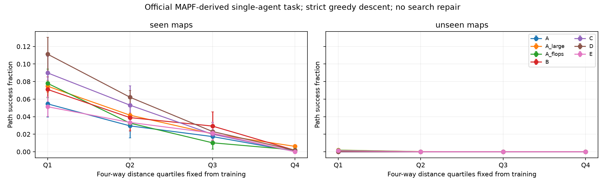
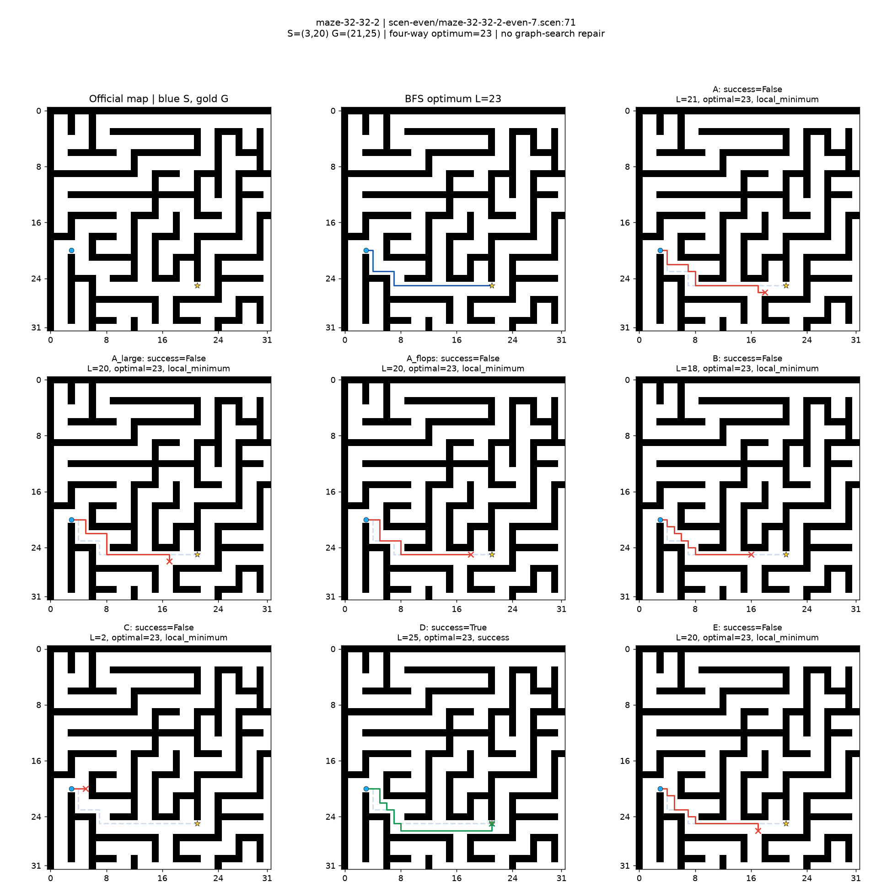

# EXP004 — Moving AI 공식 데이터의 실제 S→G 경로 탐색

## 핵심 결과와 해석

공식 자료의 적격52,516문제를 사용해 3seed×7모델의 실제 학습·평가·복원 검증을 완료했습니다. 실패는 모두 공통 디코더의 지역 최소점 정체였으며, BFS/A*로 복구하지 않았습니다. 기존 연구·공용 데이터3,426파일의 해시는 동일합니다.

| 모델 | 동일 지도 성공률(%) | 미관찰 지도 성공률(%) |
|---|---:|---:|
| A: 단일 MLP | 2.562 ± 0.716 | 0.0162 ± 0.0101 |
| A_large: 파라미터 대응 | 3.605 ± 0.211 | 0.0471 ± 0.0197 |
| A_flops: 연산량 대응 | 3.109 ± 0.806 | 0.0422 ± 0.0197 |
| B: 공유 코어8회 | 3.533 ± 1.129 | 0.0016 ± 0.0028 |
| C: 마지막 기록 헤드 | 4.132 ± 1.214 | 0.0000 ± 0.0000 |
| D: 전체 기록 헤드 | 5.010 ± 0.301 | 0.0032 ± 0.0056 |
| E: 원본만 사용하는 헤드 | 2.665 ± 0.690 | 0.0276 ± 0.0184 |

±는3seed의 표본 표준편차입니다. **도착한 사례는 있으나, 모든 모델의 절대 성공률이 낮고 미관찰 지도 일반화는 사실상 실패했습니다.**

- 반복의 이득: B는 A보다 동일 지도에서 평균0.971%p 높지만 파라미터 대응 A_large보다 낮습니다. 미관찰 지도에서도 우세하지 않으므로 반복 방식의 일반적인 우월성을 입증하지 않습니다.
- 출력 헤드의 이득: C−B=+0.599%p, D−B=+1.477%p입니다. 원본만 사용하는 E보다 높지만 코어 사전학습·추가 파라미터·추가 학습 비용을 함께 사용했습니다. 처음 보는 지도에서는 개선되지 않았습니다.
- 전체 기록의 이득: 정상 학습 D−C는 평균+0.878%p입니다. 같은 문제에서 D만/C만 성공한 건수는 seed42에서106/61, seed123에서78/90, seed2026에서92/40으로 두 번째 seed에서는 반대였습니다. 특히 학습된 D에 **R8만 복제해도5.123%**로 정상5.010%보다 높았습니다. 전체0은0.031%, 다른 문제 기록은0.589%, 역순4.886%, 순열4.896%입니다. 기록 입력에 의존하는 것과 중간 기록의 고유 정보가 꼭 필요한 것은 구분해야 합니다. 이번 결과만으로 전체 과거 기록의 필수성이나 시간 순서 추론을 입증하지 못했습니다.
- 난이도: D의 동일 지도 Q1~Q4 성공률은11.125/6.211/2.305/0.164%로 급감했습니다. D−C 차이는2.135/0.904/0.310/0.123%p여서 어려울수록 전체 기록의 추가 이득이 커지는 경향도 관찰되지 않았습니다.
- 비용: D는 seed당 평균138.16초, A는27.76초, A_large는27.12초, A_flops는31.96초였습니다. batch128의 GPU score 추론은 D 약1.213ms, A 약0.125ms, A_flops 약0.254ms입니다. 동일 지도에서의 작은 절대 이득에 비해 비용이 큽니다. CUDA 지연과 CPU 디코더 포함 지연은 별도 비교해야 하며, 빠르게 정체하는 실패 경로는 디코더 시간도 짧아질 수 있습니다.



## 추가 난이도·실패 위치 분석

아래는 동일 지도 D의3seed 평균입니다. 길이·지도 구조·우회·꺾임이 서로 관련되므로 개별 속성의 인과 효과로 해석하지 않습니다. 다른 모델과 미관찰 지도까지의 전체 표본 수·성공률·SPL·거리오차는 본 run의 additional_analysis.json에 있습니다.

| 속성 | 구간 | n | D 성공률(%) |
|---|---|---:|---:|
| 우회 비율(최단/Manhattan) | ≤1 | 1310 | 7.710 |
| 우회 비율 | (1,1.5] | 947 | 5.561 |
| 우회 비율 | (1.5,2] | 241 | 2.905 |
| 우회 비율 | >2 | 729 | 0.137 |
| 정답 경로 꺾임 | 0~2 | 236 | 12.429 |
| 정답 경로 꺾임 | 3~5 | 949 | 6.955 |
| 정답 경로 꺾임 | 6~10 | 1013 | 5.331 |
| 정답 경로 꺾임 | >10 | 1029 | 1.199 |

꺾임은 상/하/좌/우 순서로 택한 최단 경로의 속성이며 최소 꺾임 수가 아닙니다. Manhattan 거리도 훈련 사분위16/23/31에서 구분했고 모델별 전체 결과를 JSON에 남겼습니다. 미관찰 지도의 D 성공2건은 모두Q1·random-32-32-20·seed123에 속했습니다. 관찰 지도별 D 성공률은 maze-32-32-2에서0.734%, random-32-32-10에서6.193%, room-32-32-4에서8.702%입니다.

동일 지도 D의 실패 끝점에서 목표까지 실제 남은 거리는 seed별 평균32.23/32.36/31.51칸이었습니다. 실패3057/3063/3076건 중 목표4칸 이내 정체는425/474/478건, 출발점 정체는226/238/214건입니다. 목표 바로 앞 문제에만 국한된 실패는 아닙니다. 낮은 전역 MSE가 매 이웃의 올바른 점수 순서를 보장하지 못한다는 해석과 일치하지만, 손실이나 구조가 원인이라는 인과 관계는 별도 실험이 필요합니다.

대표 그림은 seed42입니다. record3689에서는 D가25칸 경로로 도착했고 최적 길이는23칸입니다. C는2칸 후 정체했습니다. 반대 사례(record1305)도 함께 보존합니다. 그림은 사례 설명이며 전체 통계 대신 선택한 성공 사례로 결론 내리지 않습니다.



[C 도착·D 정체 사례](figures/scenario_1305_paths.png), [같은 문제의 R1~R8·최종 거리장](figures/scenario_3689_distance_history.png), [기록 교란 비교](figures/history_interventions.png). Git 관리용 그림은 본 run 원본과 SHA-256이 동일하며 figures/provenance.json에 기록했습니다.

## 실행·변경·비용 집계 범위

구현 파일은 다운로드·파서·자료 검증·데이터 준비·독립 정답 탐색·모델·학습/재개·평가·시각화·복원 검증의10파일과 사후 경로 분석 analyze_results.py입니다. 설정·README·DATA_AUDIT·이 보고서·대표 그림, 상위 README 링크와 원문 지시문을 추가했습니다. 기존 EXP001~003 구현은 수정하지 않았습니다. 전체 모델·지도·난이도별 집계, 교란·비용·추가 분석·검증 결과는 Git 관리 파일 [SUMMARY.json](SUMMARY.json)에 모았습니다. 대용량 원본·체크포인트·문제별 결과는 기존 ignore 정책에 따라 로컬에 보존합니다.

EXP004 디렉터리에서 실행합니다.

```powershell
$env:PYTHONNOUSERSITE='1'
& D:\anaconda3\envs\research\python.exe src/prepare_dataset.py
& D:\anaconda3\envs\research\python.exe src/train.py --smoke
& D:\anaconda3\envs\research\python.exe src/train.py
& D:\anaconda3\envs\research\python.exe src/analyze_results.py results/<run_id>
```

본 run은20261024_001323_main_ff5cf824입니다. 코어42/C42 완료 뒤 실행 세션이 중단되어 완료 checkpoint를 재사용해 재개했습니다. 원래 source/와 재개 source 스냅샷·해시·사유를 함께 보존했습니다. 재개 로그 첫 줄의140409 ID는 당시 출력상 오류이며 해당 폴더는 생성되지 않았습니다. 실제 산출물은 위 본 run에만 있고 현재 코드는 재개한 실제 ID를 출력하도록 수정했습니다. Smoke는20261024_000032_smoke_2a9f7ac8이며 본 통계에서 제외했습니다. 결과와 checkpoint의 같은 ID는 한 실행의 두 저장 위치입니다.

seed당 코어 학습 forward는128,000회, 코어 validation은8,320회, 공유 train/val/test 기록 캐시는1,648회입니다. 각 헤드 또는 단일 MLP는 학습16,000회, validation1,040회, 정상 평가93회입니다. D 교란은추가1,209회 헤드 호출입니다. 지연 측정은 모델별 전체 시스템100회(준비10+측정3종×30)로 C/D/B의 한 시스템 호출은 코어8회를 포함합니다. 이 단위는 표본 수가 아닌 **배치별 모듈 forward 횟수**입니다. 구조 검사·복원 재검사·중단 후 캐시 재계산은 별도 검증 오버헤드이며 과학적 학습 예산과 구분합니다.

학습 시간에는 해당 fit의 validation과 gradient 기록이 포함되고 캐시·IO는 별도입니다. C/D의 시스템 학습 예산에는 코어를 각각 포함하지만 실제로는 seed당 한 코어를 공유했습니다. Peak allocated는 당시 공용 텐서·캐시를 포함하므로 모델 자체의 추가 메모리는 JSON의 증분값도 함께 보아야 합니다. 동일 지도·목표를 공유하는 여러 S가 있어 문제별 관측은 독립이 아니며, seed 표준편차로 통계적 유의성을 주장하지 않습니다.

**Moving AI 공식 MAPF 지도·시나리오에서 추출한 단일 에이전트 경로 탐색 평가**입니다. 공식 단일 에이전트 모델 평가 점수 또는 다중 에이전트 충돌 해결 성능이 아닙니다.

run_id=`20261024_001323_main_ff5cf824`, smoke=False, seed=[42, 123, 2026]. 코어/헤드/A 각80epoch가 기본이며 이 실행은 80/80/80epoch입니다.

## 원본과 파생 과제

출처: [공식 MAPF 자료](https://movingai.com/benchmarks/mapf/index.html), [MAPF 안내·인용](https://movingai.com/benchmarks/mapf.html), [파일 형식](https://movingai.com/benchmarks/formats.html), [그리드 자료](https://movingai.com/benchmarks/grids.html). 공식 안내의 Open Data Commons Attribution License를 따르는 연구 자료이며, 출처 인용은 Stern et al., “Multi-Agent Pathfinding: Definitions, Variants, and Benchmarks”, SoCS 2019, pp.151–158입니다.
5개 공식32×32 지도와 각25개 even/25개 random 파일을 원본 ZIP 그대로 보존했습니다. 실제 파일은 version1/9필드 구조였고, 마지막 값은 별도8방향·sqrt(2)·corner-cut 금지 Dijkstra와 대조했습니다. 우리의 최적 길이는 이 값을 쓰지 않고 4방향 단위 비용 BFS와 독립 Dijkstra가 일치하는 값입니다. G/S 지형 문자를 좌표로 해석하지 않습니다. 좌표 원점은 좌상단, x=열/y=행이며 지도 변형·자체 시나리오 생성이 없습니다.
원본67765행, 파싱 실패0행. 필터 결과: `{'accepted': 52516, 'four_way_distance_below_12': 9782, 'identical_start_goal': 50, 'duplicate_map_start_goal': 5417}`. 최소12칸 필터를 완화하지 않았습니다. 원본 비용 대조 최대 오차=1.22e-08. 원본 URL·UTC 다운로드 시각·archive/member SHA-256은 data/movingai_exp004/download_manifest.json, 행별 제외 사유는 준비 데이터의 row_ledger.jsonl에 있습니다.

| split | 문제 수 | 실제 거리 min/mean/max | Q1/Q2/Q3/Q4 개수 |
|---|---:|---|---|
| train | 25548 | 12/38.43/140 | [6532, 6568, 6189, 6259] |
| val | 3208 | 12/37.22/141 | [877, 806, 777, 748] |
| test_seen | 3227 | 12/39.07/134 | [812, 848, 752, 815] |
| test_unseen | 20533 | 12/38.42/107 | [4911, 4790, 4914, 5918] |

maze-32-32-4와 random-32-32-20은 학습·검증에서 지도 전체를 제외했습니다. 나머지3개 지도는 목표 지점 단위로80/10/10% 분리했습니다. 거리장 정답은 S와 무관하게 같은 지도·G에서 동일하므로, 새 S만 바꾼 동일 거리장 정답이 학습/테스트에 겹치는 것을 방지한 더 엄격한 동일 지도 평가입니다. S와 G는 모든 모델 입력에 포함됩니다.
훈련 거리의 nearest 사분위수=[21, 31, 46]. Q1=12~21, Q2=22~31, Q3=32~46, Q4≥47이며 테스트로 경계를 정하지 않았습니다. 지도별·구간별 표본 수를 함께 보고합니다. 2개의 미관찰 지도로부터 일반 지도 전체의 일반화를 주장하지 않습니다.

## 경로 성공·최적성·오류

| 평가 | 모델 | n | 도착 성공률 | 전체 최적 성공률 | 성공한 경로 비용비 | SPL | 합법 경로율 | 정체 실패율 | 거리 MAE |
|---|---|---:|---:|---:|---:|---:|---:|---:|---:|
| seen | A | 3227 | 0.025617 ± 0.007163 | 0.024171 ± 0.007208 | 1.009414 ± 0.003736 | 0.025431 ± 0.007183 | 1.000000 ± 0.000000 | 0.974383 ± 0.007163 | 9.166044 ± 0.107435 |
| seen | A_large | 3227 | 0.036050 ± 0.002109 | 0.033674 ± 0.002580 | 1.008294 ± 0.002118 | 0.035791 ± 0.002162 | 1.000000 ± 0.000000 | 0.963950 ± 0.002109 | 9.442515 ± 0.105371 |
| seen | A_flops | 3227 | 0.031092 ± 0.008059 | 0.028613 ± 0.006855 | 1.008361 ± 0.000996 | 0.030858 ± 0.007972 | 1.000000 ± 0.000000 | 0.968908 ± 0.008059 | 9.839446 ± 0.163948 |
| seen | B | 3227 | 0.035327 ± 0.011289 | 0.033364 ± 0.010110 | 1.005134 ± 0.002072 | 0.035151 ± 0.011188 | 1.000000 ± 0.000000 | 0.964673 ± 0.011289 | 8.036773 ± 0.058188 |
| seen | C | 3227 | 0.041318 ± 0.012138 | 0.040388 ± 0.011939 | 1.002751 ± 0.000204 | 0.041218 ± 0.012107 | 1.000000 ± 0.000000 | 0.958682 ± 0.012138 | 7.992021 ± 0.038339 |
| seen | D | 3227 | 0.050098 ± 0.003010 | 0.047826 ± 0.002812 | 1.004368 ± 0.001099 | 0.049904 ± 0.003009 | 1.000000 ± 0.000000 | 0.949902 ± 0.003010 | 8.061541 ± 0.105781 |
| seen | E | 3227 | 0.026650 ± 0.006901 | 0.025617 ± 0.006458 | 1.006608 ± 0.001939 | 0.026499 ± 0.006833 | 1.000000 ± 0.000000 | 0.973350 ± 0.006901 | 9.155354 ± 0.358488 |
| unseen | A | 20533 | 0.000162 ± 0.000101 | 0.000097 ± 0.000049 | 1.046154 ± 0.041429 | 0.000154 ± 0.000094 | 1.000000 ± 0.000000 | 0.999838 ± 0.000101 | 35.106225 ± 0.214458 |
| unseen | A_large | 20533 | 0.000471 ± 0.000197 | 0.000390 ± 0.000129 | 1.022877 ± 0.029046 | 0.000460 ± 0.000187 | 1.000000 ± 0.000000 | 0.999529 ± 0.000197 | 35.240125 ± 0.953327 |
| unseen | A_flops | 20533 | 0.000422 ± 0.000197 | 0.000373 ± 0.000157 | 1.019814 ± 0.023281 | 0.000414 ± 0.000190 | 1.000000 ± 0.000000 | 0.999578 ± 0.000197 | 34.884270 ± 1.306861 |
| unseen | B | 20533 | 0.000016 ± 0.000028 | 0.000016 ± 0.000028 | 1.000000 ± 0.000000 | 0.000016 ± 0.000028 | 1.000000 ± 0.000000 | 0.999984 ± 0.000028 | 34.333183 ± 1.514874 |
| unseen | C | 20533 | 0.000000 ± 0.000000 | 0.000000 ± 0.000000 | N/A | 0.000000 ± 0.000000 | 1.000000 ± 0.000000 | 1.000000 ± 0.000000 | 46.255457 ± 1.791274 |
| unseen | D | 20533 | 0.000032 ± 0.000056 | 0.000016 ± 0.000028 | 1.153846 ± 0.000000 | 0.000029 ± 0.000050 | 1.000000 ± 0.000000 | 0.999968 ± 0.000056 | 45.406716 ± 1.872257 |
| unseen | E | 20533 | 0.000276 ± 0.000184 | 0.000244 ± 0.000129 | 1.013056 ± 0.022613 | 0.000271 ± 0.000175 | 1.000000 ± 0.000000 | 0.999724 ± 0.000184 | 36.708966 ± 0.733734 |

±는 seed 간 표본 표준편차이며 신뢰구간이나 유의성을 뜻하지 않습니다. 비용비는 성공한 경로만의 조건부 평균이므로 성공률과 전체 최적 성공률·SPL을 별도 제시했습니다. SPL=성공 여부×최적 길이/max(실제 길이,최적 길이)로 실패는0입니다. 최적 경로가 여럿이면 어떤 최단 경로든 인정합니다. 성공한 경로가 없는 조건부 비용비는 N/A입니다.
합법 경로율은 실패한 부분 경로도 포함합니다. 디코더가 벽·범위를 미리 검사하므로 합법성100%는 모델이 벽을 학습했다는 증거가 아닙니다. 모델 점수가 가장 낮은 이웃이 벽인 빈도는 illegal_best_event_rate로 별도 기록합니다. 지도 밖에는 모델 출력 점수가 없으므로 해당 방향을 임의 점수로 순위화하지 않았습니다. 엄격 감소 때문에 루프는 구조적으로 억제되며 이를 학습 성과라고 해석하지 않습니다.

## 거리 난이도별 성공률

| 평가 | 거리 구간 | n | A | A_large | A_flops | B | C | D | E |
|---|---|---:|---:|---:|---:|---:|---:|---:|---:|
| seen | Q1 | 812 | 0.054598 ± 0.015200 | 0.074713 ± 0.006783 | 0.077997 ± 0.016261 | 0.071018 ± 0.014380 | 0.089901 ± 0.018959 | 0.111248 ± 0.019329 | 0.051314 ± 0.011175 |
| seen | Q2 | 848 | 0.029481 ± 0.013600 | 0.041667 ± 0.002455 | 0.032626 ± 0.009007 | 0.038915 ± 0.015056 | 0.053066 ± 0.022093 | 0.062107 ± 0.007852 | 0.033412 ± 0.005573 |
| seen | Q3 | 752 | 0.017287 ± 0.005796 | 0.020390 ± 0.002031 | 0.010195 ± 0.007324 | 0.029255 ± 0.016178 | 0.019947 ± 0.007404 | 0.023050 ± 0.009981 | 0.021277 ± 0.012685 |
| seen | Q4 | 815 | 0.000409 ± 0.000708 | 0.006135 ± 0.002125 | 0.002045 ± 0.002554 | 0.001636 ± 0.001874 | 0.000409 ± 0.000708 | 0.001636 ± 0.000708 | 0.000000 ± 0.000000 |
| unseen | Q1 | 4911 | 0.000679 ± 0.000424 | 0.001833 ± 0.000734 | 0.001697 ± 0.000771 | 0.000068 ± 0.000118 | 0.000000 ± 0.000000 | 0.000136 ± 0.000235 | 0.001154 ± 0.000771 |
| unseen | Q2 | 4790 | 0.000000 ± 0.000000 | 0.000139 ± 0.000241 | 0.000070 ± 0.000121 | 0.000000 ± 0.000000 | 0.000000 ± 0.000000 | 0.000000 ± 0.000000 | 0.000000 ± 0.000000 |
| unseen | Q3 | 4914 | 0.000000 ± 0.000000 | 0.000000 ± 0.000000 | 0.000000 ± 0.000000 | 0.000000 ± 0.000000 | 0.000000 ± 0.000000 | 0.000000 ± 0.000000 | 0.000000 ± 0.000000 |
| unseen | Q4 | 5918 | 0.000000 ± 0.000000 | 0.000000 ± 0.000000 | 0.000000 ± 0.000000 | 0.000000 ± 0.000000 | 0.000000 ± 0.000000 | 0.000000 ± 0.000000 | 0.000000 ± 0.000000 |

지도별 전체 지표는 comparison.csv/aggregate.json의 seen/mapN·unseen/mapN에 있습니다. map0~4 순서는 설정 maps 배열과 같습니다. 예측 실제 경로·실패 사유는 *_paths.json에 원본 record_index와 함께 보존합니다.

## 연구 질문에 대한 직접 비교

- seen: 실제 도착 성공률 D=0.050098, C=0.041318, B=0.035327. C−B=+0.005991, D−C=+0.008780, D−A=+0.024481, D−A_large=+0.014048, D−A_flops=+0.019006.
  C/D는 같은 동결 코어와 헤드 초기화·배치를 사용했습니다. C−B에는 추가 최종 손실 학습·파라미터·원본 직접 접근이 포함됩니다. D−C가 전체 기록 추가 이익의 가장 직접적인 비교입니다. 거리장 MAE 감소와 도착 성공은 같은 지표가 아닙니다.
- unseen: 실제 도착 성공률 D=0.000032, C=0.000000, B=0.000016. C−B=-0.000016, D−C=+0.000032, D−A=-0.000130, D−A_large=-0.000438, D−A_flops=-0.000390.
  C/D는 같은 동결 코어와 헤드 초기화·배치를 사용했습니다. C−B에는 추가 최종 손실 학습·파라미터·원본 직접 접근이 포함됩니다. D−C가 전체 기록 추가 이익의 가장 직접적인 비교입니다. 거리장 MAE 감소와 도착 성공은 같은 지표가 아닙니다.

## 학습된 D의 기록 교란

| 평가 | 교란 | 도착 성공률 | 정상 D 대비 변화 | 거리 MAE |
|---|---|---:|---:|---:|
| seen | other_sample_all | 0.005888 ± 0.001117 | -0.044210 | 17.515726 ± 0.235665 |
| seen | repeat_last | 0.051234 ± 0.003997 | +0.001136 | 7.957707 ± 0.088739 |
| seen | reverse | 0.048859 ± 0.001464 | -0.001240 | 8.124669 ± 0.128315 |
| seen | shuffle | 0.048962 ± 0.001885 | -0.001136 | 8.131204 ± 0.139046 |
| seen | zero_R1 | 0.016734 ± 0.011824 | -0.033364 | 8.775648 ± 0.344461 |
| seen | zero_R2 | 0.030472 ± 0.002707 | -0.019626 | 8.396622 ± 0.057641 |
| seen | zero_R3 | 0.036257 ± 0.000820 | -0.013842 | 8.255997 ± 0.039532 |
| seen | zero_R4 | 0.036566 ± 0.001610 | -0.013532 | 8.266169 ± 0.043624 |
| seen | zero_R5 | 0.035120 ± 0.000473 | -0.014978 | 8.278659 ± 0.017878 |
| seen | zero_R6 | 0.036773 ± 0.001252 | -0.013325 | 8.279987 ± 0.020887 |
| seen | zero_R7 | 0.035843 ± 0.000716 | -0.014255 | 8.277990 ± 0.027710 |
| seen | zero_R8 | 0.035534 ± 0.001464 | -0.014565 | 8.282267 ± 0.021691 |
| seen | zero_all | 0.000310 ± 0.000000 | -0.049788 | 19.356056 ± 0.456972 |
| unseen | other_sample_all | 0.000016 ± 0.000028 | -0.000016 | 47.208083 ± 1.393532 |
| unseen | repeat_last | 0.000016 ± 0.000028 | -0.000016 | 45.205719 ± 1.921640 |
| unseen | reverse | 0.000032 ± 0.000056 | +0.000000 | 45.451069 ± 1.862532 |
| unseen | shuffle | 0.000032 ± 0.000056 | +0.000000 | 45.456346 ± 1.836089 |
| unseen | zero_R1 | 0.000032 ± 0.000056 | +0.000000 | 43.605136 ± 2.479740 |
| unseen | zero_R2 | 0.000016 ± 0.000028 | -0.000016 | 45.529219 ± 1.660004 |
| unseen | zero_R3 | 0.000016 ± 0.000028 | -0.000016 | 45.587547 ± 1.937075 |
| unseen | zero_R4 | 0.000016 ± 0.000028 | -0.000016 | 45.480427 ± 1.849858 |
| unseen | zero_R5 | 0.000016 ± 0.000028 | -0.000016 | 45.501977 ± 1.918425 |
| unseen | zero_R6 | 0.000016 ± 0.000028 | -0.000016 | 45.611516 ± 1.825764 |
| unseen | zero_R7 | 0.000016 ± 0.000028 | -0.000016 | 45.505336 ± 1.887034 |
| unseen | zero_R8 | 0.000016 ± 0.000028 | -0.000016 | 45.549749 ± 1.955232 |
| unseen | zero_all | 0.000032 ± 0.000028 | +0.000000 | 23.253020 ± 0.388969 |

교란은 전체0, R8복제, 역순, 고정 무작위 순열 [4,1,7,2,8,5,3,6], 평가 문제 순서를1칸 순환한 다른 공식 시나리오 기록, R1~R8 각각0 대체입니다. 학습된 D는 바꾸지 않았습니다. 분포 밖 입력이므로 저하만으로 과거 기록의 근본적 해결 능력이나 시간 이해를 입증하지 않습니다.

## 비용과 학습 조건

| 모델 | 전체 파라미터 | 전체 steps | 코어 포함 학습초 | score GPU ms/batch | 전송+decoder ms/batch | forward MFLOPs/sample | peak allocated MiB |
|---|---:|---:|---:|---:|---:|---:|---:|
| A | 1049856 | 16000 | 27.76 | 0.1252 | 5.6876 | 2.0972 | 2759.49 |
| A_large | 4458560 | 16000 | 27.12 | 0.1816 | 7.8933 | 8.9129 | 2824.15 |
| A_flops | 13635840 | 16000 | 31.96 | 0.2543 | 9.0888 | 27.2630 | 2999.16 |
| B | 1312000 | 16000 | 109.02 | 1.0223 | 13.5851 | 20.9715 | 1146.28 |
| C | 4459008 | 32000 | 138.12 | 1.2762 | 4.7368 | 27.2630 | 2818.49 |
| D | 4459008 | 32000 | 138.16 | 1.2130 | 4.1361 | 27.2630 | 2811.49 |
| E | 3147008 | 16000 | 29.14 | 0.2644 | 5.6730 | 6.2915 | 2809.49 |

AdamW lr=0.001, weight_decay=0.01, batch=128, FP32, TF32 비활성, deterministic입니다. 마지막 epoch를 고정 사용하고 validation은 관찰용이며 테스트로 모델을 고르지 않았습니다.
정규화 y=d/128, 역변환 d=score×128이며 값은 자르지 않습니다. 모든 모델은 Softplus 양수 점수를 출력합니다. G 연결 성분의 도달 가능 셀만 표본별 평균 MSE에 포함합니다. 벽과 도달 불가 빈칸은 모두 거리 손실에서 제외하되 원본 벽 지도와 거리 mask로 구분합니다. R0는 전부1(128칸 추정)입니다. W/S/G는 매 반복 원본을 유지하며 실제 예측 R을 재입력하고 전체 BPTT로 학습합니다. 모든 단계의 목표는 같은 최종 거리장이며 core loss=0.5×마지막 손실+0.5×8단계 평균(마지막의 총 가중치0.5625)입니다. 헤드/A는 최종 MSE만 사용합니다. BFS 중간 정답을 헤드에 입력하지 않고 G 점수를 강제0으로 바꾸거나 후처리 검색으로 실패를 복구하지 않았습니다.
C/D의 비용에는 동일 코어 사전학습을 각각 포함하며 E에는 코어 비용이 없습니다. A_large는 코어+헤드 파라미터 수 근사 대응, A_flops는 코어8회+헤드1회 선형 forward FLOPs 대응이며 동일 wall-time 학습과는 다릅니다. 선형 multiply-add=2로 계산하고 비선형·cat·역전파·optimizer·CPU 디코더는 FLOPs에 포함하지 않습니다. 캐시 준비와 IO는 별도 기록합니다. 실제 추론 C/D는 코어8회와 헤드1회를 재계산하고 E는 헤드1회만 실행합니다. warm-up·측정 횟수·표준편차·전송 시간·증분 메모리는 summary.json에 있습니다. 8×1024 FP32 기록은 sample당32KiB입니다.

## 검증·한계·후속

공식 파일 archive/member SHA-256, 실제9필드·좌표, 전체 BFS/Dijkstra 거리장 3879개, 적격 문제 전체 oracle 디코더 성공·최적100%, 분할 중복/지도 holdout, 모델 W/S/G 입력·공유 가중치·동결·헤드 초기화, 모든 checkpoint 출력/경로/교란 재현을 확인했습니다. 기존 연구와 기존 공용 데이터 3426개 파일의 해시가 일치합니다. 시각화도 원본 벽·공식 S/G·oracle 경로·실제 예측 경로를 직접 대조합니다.
거리장 감독은 G가 같으면 S와 무관한 정답입니다. S 입력을 포함해도 이 목적함수가 S 의존 정책 학습을 직접 강제하는 것은 아닙니다. 낮은 전역 MSE가 모든 이웃의 정확한 상대 순서나 G 근처 단조 하강을 보장하지 않습니다. 실패는 수정하지 않고 그대로 보고합니다. 제한된5개지도, holdout2개와 지도 계열 차이, 마지막epoch 고정, MLP의 표현과 학습 설정에 한계가 있습니다. 이전 연결 영역 IoU와 이번 실제 경로 성공률을 합쳐 비교하지 않습니다.
후속 후보는 공식 지도 범위 확장·지도단위 교차 검증, 별도run의학습예산/epoch/거리손실비교입니다. 경로 성공을 올리려고 BFS/A*로 결과를 완성하는 비교는 이번 범위에서 수행하지 않습니다.
