# EXP001 — 잠재 Attention 반복 추론 v0.1 결과

## 연구 질문에 대한 답

1. **잠재 상태도 학습되는가?** 학습 신호와 일부 실제 완주를 확인했습니다. B는 같은 공식16문제에서7,000스텝 후15/16완주·loss0.0787로 엄격 기준을 통과했습니다. A는2만스텝 후8/16완주로 미달했습니다. 잠재 상태가 특정 사고 내용을 나타낸다고 해석하지 않습니다.
2. **독립1회보다16회가 좋은가?** 관찰 지도 평균은 A=6.67%, B=9.12%로 B−A=+2.45%p입니다. 그러나 B가 A보다 높은 시드는1/3개였고 B의 표본SD는7.65%p였습니다. 평균 이득을 일관된 우위로 일반화할 수 없습니다.
3. **과거 기록이 도움이 되는가?** C=7.52%이며 B−C=+1.60%p, B가 높은 시드는2/3개입니다. 정상 학습 B/C가 직접 비교이고, 기록 교란은 분포 밖 입력 진단입니다. Attention 비중이나 일부 교란 저하만으로 기록의 필수성을 입증하지 않습니다.
4. **종료 시점을 학습했는가?** 검증에서는 모든 후보가16회까지 계속했습니다. 관찰 테스트도 평균16회·강제종료100%였습니다. 종료 헤드의 gradient·샘플링·로그확률은 검증됐지만, 유용한 조기 종료를 학습한 결과는 아닙니다.
5. **품질을 유지하면서 실제 계산을 줄였는가?** 채택된 자율 종료 정책은0/3개입니다. 이번 설정에서는 계산 절약에 실패해 고정16회를 유지합니다. 반복 수가 같으면 종료 판단의 추가 비용도 생깁니다.
6. **새 공식 지도에서도 풀리는가?** B의 미관찰 지도 평균 완주율은0.198%입니다. 일부 완주 사례는 있지만 실용적인 일반화 성능을 확보하지 못했습니다. 보유 지도는5개, 미관찰 평가는2개입니다.
7. **다음에는 무엇 하나만 바꿀 것인가?** 구조·데이터·라벨·배치·학습률은 고정하고, 새 run에서 solver epoch 상한만80→160으로 늘려 최적화 부족의 영향을 먼저 분리하는 것이 적절합니다. 이번에는 후반 손실 개선과 시드 변동이 컸습니다. 공동 종료 미세조정은 학습 조건이 달라지므로 수행하지 않았고 별도 후속 실험으로 남깁니다.

A는 이번 실험의 **1회 Attention 모델**이며, 이전 SH001의 단일 MLP와 다른 기준선입니다. 또한 EXP004와는 감독 목표·정책 디코더가 달라 성공률 차이를 잠재 구조만의 효과로 해석할 수 없습니다.

Solver 학습 run은 `20261024_163337_solver_390e42f9`, 종료 정책 학습 run은 `20261024_181350_halt_57bd85b2`, 최종 추론 감사 run은 `20261024_185845_runtime_review_33602d1b`입니다. Seed는42/123/2026, FP32, solver별80epoch, 배치256입니다. Smoke와 소규모 과적합 결과는 본 성능에서 제외했습니다.

## 먼저 확인한 한계

16개 공식 훈련 문제의 과적합 엄격 기준(완주율≥90%, 최종loss<0.15)에 A/B 모두 통과했는가: False. 조건별 결과는 아래 표에 구분했습니다. 손실 감소와 일부 완주를 확인해도 모든 조건이 소집합을 완전히 학습했다는 뜻이 아닙니다. 일반화 실패를 미로 복잡도만으로 설명하지 않습니다.

과적합 검사는 같은 공식16문제·구조·라벨·손실을 유지했고, 학습 스텝만2천→1만→2만 상한으로 연장했습니다. 이미 기준에 도달한 B는 재학습하지 않았습니다. 실패 결과와 연장 출처도 보존합니다.

| 모델 | 초기loss | 마지막loss | 최종 완주율 | optimizer 누적steps | 엄격 기준 |
|---|---:|---:|---:|---:|---|
| A | 1.027113 | 0.107233 | 50.00% | 20000 | False |
| B | 1.026968 | 0.078727 | 93.75% | 7000 | True |

## 실제 완주·최적성

| 평가 | 모델 | n/seed | 성공률% ± seed SD | SPL | 전체 최적 성공률% | 최종 정책 손실 |
|---|---|---:|---:|---:|---:|---:|
| seen | A | 3227 | 6.6729 ± 5.8208 | 0.0662 ± 0.0577 | 6.0324 ± 5.1400 | 0.2719 ± 0.1523 |
| seen | B | 3227 | 9.1210 ± 7.6531 | 0.0907 ± 0.0762 | 8.6148 ± 7.2323 | 0.3122 ± 0.2174 |
| seen | C | 3227 | 7.5199 ± 6.3397 | 0.0744 ± 0.0626 | 6.5592 ± 5.3527 | 0.2986 ± 0.2248 |
| unseen | A | 20533 | 0.0601 ± 0.0516 | 0.0006 ± 0.0005 | 0.0536 ± 0.0494 | 1.5256 ± 0.2498 |
| unseen | B | 20533 | 0.1981 ± 0.2324 | 0.0019 ± 0.0023 | 0.1721 ± 0.2028 | 1.4792 ± 0.3730 |
| unseen | C | 20533 | 0.1347 ± 0.0171 | 0.0013 ± 0.0002 | 0.1299 ± 0.0203 | 1.5191 ± 0.4290 |

A는 독립 학습한1회 모델, B는 기록을 읽는 공유16회, C는 원본만 읽는 공유16회입니다. 같은seed의 초기 구조·가중치·학습 문제 순서를 대응시켰습니다. 중간 정책 손실 없이 마지막 출력만 감독했습니다.

- seen: B−A=+2.4481%p, B−C=+1.6011%p. 절단한 B의1회 추론을 A 기준선으로 사용하지 않았습니다.
- unseen: B−A=+0.1380%p, B−C=+0.0633%p. 절단한 B의1회 추론을 A 기준선으로 사용하지 않았습니다.

## 거리별·지도별

| 평가·구간 | n/seed | A 성공률% | B 성공률% | C 성공률% |
|---|---:|---:|---:|---:|
| seen/Q1 | 812 | 10.4269 ± 6.0612 | 14.2857 ± 10.7764 | 12.0690 ± 8.8499 |
| seen/Q2 | 848 | 7.4686 ± 7.0964 | 9.1588 ± 8.2187 | 6.9575 ± 6.6698 |
| seen/Q3 | 752 | 3.8121 ± 3.5241 | 5.4521 ± 4.7557 | 4.5656 ± 4.5879 |
| seen/Q4 | 815 | 4.7444 ± 7.1559 | 7.3211 ± 6.7343 | 6.2986 ± 5.5042 |
| seen/map0 | 1136 | 7.9519 ± 6.8596 | 9.9472 ± 7.6072 | 8.5974 ± 6.6677 |
| seen/map2 | 1141 | 10.4002 ± 10.1227 | 15.0453 ± 13.5623 | 11.1598 ± 9.6344 |
| seen/map4 | 950 | 0.6667 ± 0.5986 | 1.0175 ± 1.1157 | 1.8596 ± 2.2925 |
| unseen/Q1 | 4911 | 0.2376 ± 0.1978 | 0.7873 ± 0.9473 | 0.4412 ± 0.1633 |
| unseen/Q2 | 4790 | 0.0139 ± 0.0241 | 0.0418 ± 0.0362 | 0.1113 ± 0.1223 |
| unseen/Q3 | 4914 | 0.0000 ± 0.0000 | 0.0000 ± 0.0000 | 0.0136 ± 0.0235 |
| unseen/Q4 | 5918 | 0.0000 ± 0.0000 | 0.0000 ± 0.0000 | 0.0000 ± 0.0000 |
| unseen/map1 | 11477 | 0.0813 ± 0.0630 | 0.3050 ± 0.4462 | 0.2323 ± 0.0393 |
| unseen/map3 | 9056 | 0.0331 ± 0.0481 | 0.0626 ± 0.1084 | 0.0110 ± 0.0110 |

map0~4는 maze-32-32-2 / maze-32-32-4 / random-32-32-10 / random-32-32-20 / room-32-32-4입니다. Q1=12~21, Q2=22~31, Q3=32~46, Q4≥47입니다. 빈 구간은 JSON에 n=0으로 남기고 보간하지 않았습니다.

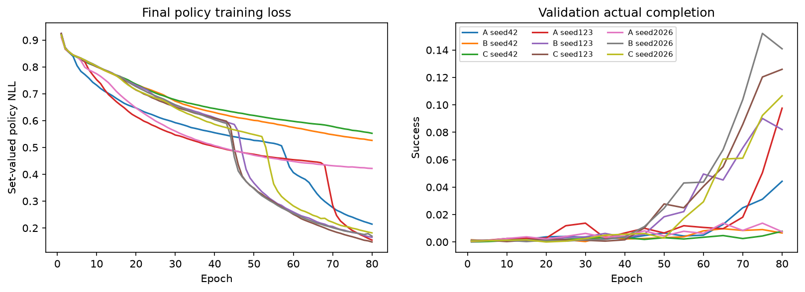

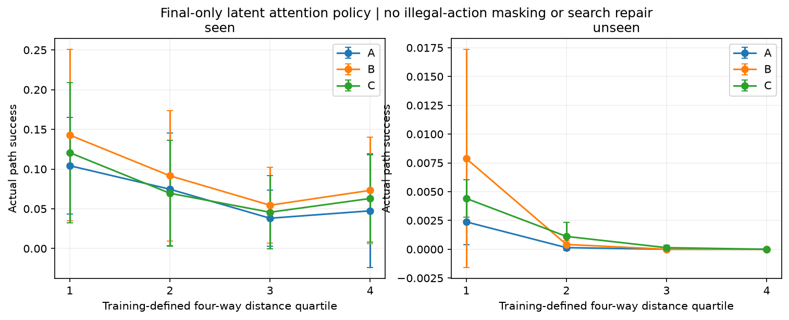

## 종료 정책: 검증으로 선택, 테스트는 결과 확인만

| seed | lambda | 검증 성공률% | 검증 평균T | 관찰 성공률% | 미관찰 성공률% | 관찰 강제16 비율 | 품질 유지 | 실제 절약 채택 |
|---|---:|---:|---:|---:|---:|---:|---|---|
| 42 | 0.0 | 0.9663 | 16.000 | 0.7127 | 0.0097 | 1.0000 | True | False |
| 42 | 0.001 | 0.9663 | 16.000 | 0.7127 | 0.0097 | 1.0000 | True | False |
| 42 | 0.01 | 0.9663 | 16.000 | 0.7127 | 0.0097 | 1.0000 | True | False |

seed42 최종 선택: `{'seed': 42, 'adopted_penalty': None, 'fallback': 'fixed16', 'selection_uses_test': False, 'reason': 'zero observed overall/Q-bin validation success and SPL drop plus actual batch1 speedup required', 'latency_basis': 'stratified varied validation cases, paired measurement; no test selection'}`.

| 123 | 0.0 | 9.0087 | 16.000 | 10.9699 | 0.4578 | 1.0000 | True | False |
| 123 | 0.001 | 9.0087 | 16.000 | 10.9699 | 0.4578 | 1.0000 | True | False |
| 123 | 0.01 | 9.0087 | 16.000 | 10.9699 | 0.4578 | 1.0000 | True | False |

seed123 최종 선택: `{'seed': 123, 'adopted_penalty': None, 'fallback': 'fixed16', 'selection_uses_test': False, 'reason': 'zero observed overall/Q-bin validation success and SPL drop plus actual batch1 speedup required', 'latency_basis': 'stratified varied validation cases, paired measurement; no test selection'}`.

| 2026 | 0.0 | 15.2120 | 16.000 | 15.6802 | 0.1266 | 1.0000 | True | False |
| 2026 | 0.001 | 15.2120 | 16.000 | 15.6802 | 0.1266 | 1.0000 | True | False |
| 2026 | 0.01 | 15.2120 | 16.000 | 15.6802 | 0.1266 | 1.0000 | True | False |

seed2026 최종 선택: `{'seed': 2026, 'adopted_penalty': None, 'fallback': 'fixed16', 'selection_uses_test': False, 'reason': 'zero observed overall/Q-bin validation success and SPL drop plus actual batch1 speedup required', 'latency_basis': 'stratified varied validation cases, paired measurement; no test selection'}`.

검증 전체와 각Q1~Q4의 성공률/SPL 관측 저하0, 평균T 감소, batch1 실측 지연 감소를 모두 요구했습니다. 고정16회 검증 성공이0이면 계산 감소만으로 채택하지 않습니다. 조건을 만족하지 못하면 원래 고정16회 결과를 유지합니다. 강제16회는 마지막Bernoulli continue, 자율16회는 halt입니다. 실제 추론에서는 종료 문제를 활성 배치에서 제거합니다.

REINFORCE는 실제 선택한 종료 상태 한 번의 정책 손실+2×실패+lambda×T/16 비용을 최소화합니다. 비용baseline은 이전 minibatch 비용EMA로 현재 행동과 독립이며, loss=(cost-baseline).detach()×선택logp합입니다. 모든 가능한 종료 손실을 평균하는 목적함수로 바꾸지 않았습니다. 로그확률·행동·비용·baseline은 각후보actions.jsonl에 있습니다. 동결16회 잠재 캐시는 학습 최적화이며 캐시준비시간과 실제adaptive지연은 분리했습니다.

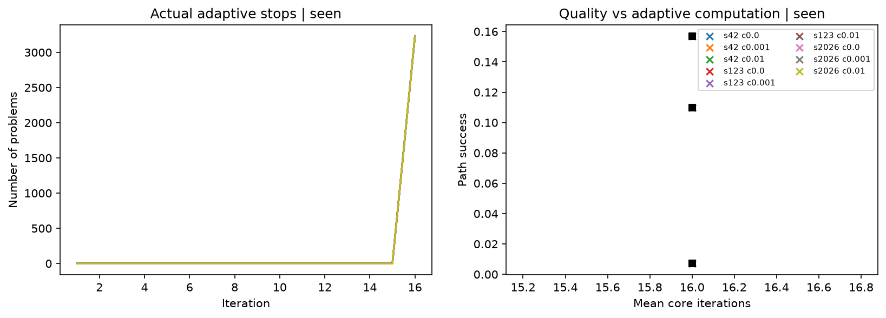

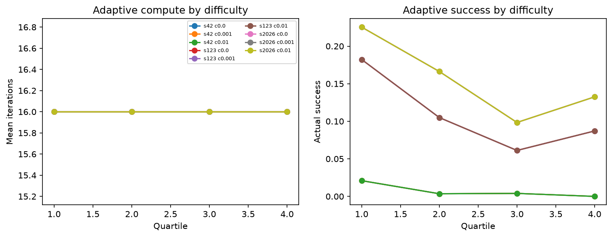

검증 성공률의 기술적 Wilson95% 구간(문제 간 상관을 무시한 참고치)은 다음과 같습니다. 통계적 비열등성 증명으로 사용하지 않습니다.

| seed | lambda | 고정16회 성공률 구간% | 종료정책 성공률 구간% |
|---|---:|---|---|
| 42 | 0.0 | 0.682~1.368 | 0.682~1.368 |
| 42 | 0.001 | 0.682~1.368 | 0.682~1.368 |
| 42 | 0.01 | 0.682~1.368 | 0.682~1.368 |
| 123 | 0.0 | 8.066~10.049 | 8.066~10.049 |
| 123 | 0.001 | 8.066~10.049 | 8.066~10.049 |
| 123 | 0.01 | 8.066~10.049 | 8.066~10.049 |
| 2026 | 0.0 | 14.011~16.496 | 14.011~16.496 |
| 2026 | 0.001 | 14.011~16.496 | 14.011~16.496 |
| 2026 | 0.01 | 14.011~16.496 | 14.011~16.496 |

## 비용

| 모델 | 파라미터 | 평균 학습초 | train optimizer steps | 선형·attention forward MFLOPs/문제 | batch1 모델 ms | batch16 ms | batch64 ms |
|---|---:|---:|---:|---:|---:|---:|---:|
| A | 397828 | 205.06 | 8000 | 263.848 | 1.753 | 2.107 | 2.061 |
| B | 397828 | 837.33 | 8000 | 533.201 | 16.571 | 19.023 | 19.179 |
| C | 397828 | 687.02 | 8000 | 501.744 | 10.288 | 13.073 | 12.631 |

배치별 std·최대 지연·추가 메모리, 훈련peak allocated/증분, 코어·헤드 호출 횟수, 종료후보별 실제 지연은 SUMMARY.json에 있습니다. FLOPs는 곱셈+덧셈2, Linear 및QK/AV만 포함하고 LayerNorm·GELU·softmax·역전파·optimizer·CPU디코더는 제외합니다. 공유 가중치가 계산량 또는 메모리 일정함을 뜻하지 않습니다. 과거 기록이 늘면 attention 길이도 늘어납니다.

## 반복 진단과 실패 해석

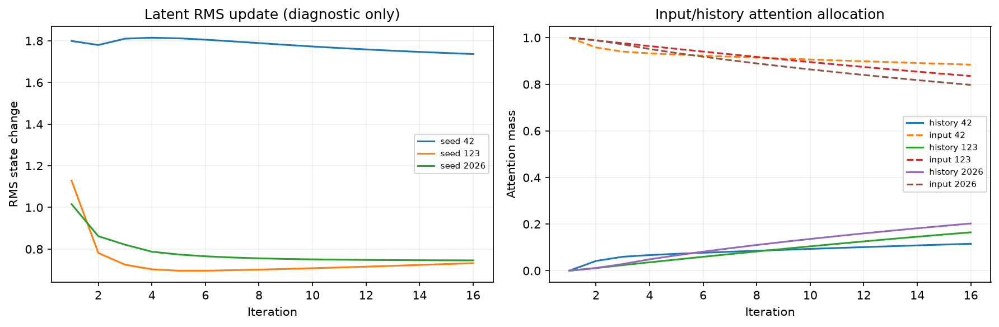

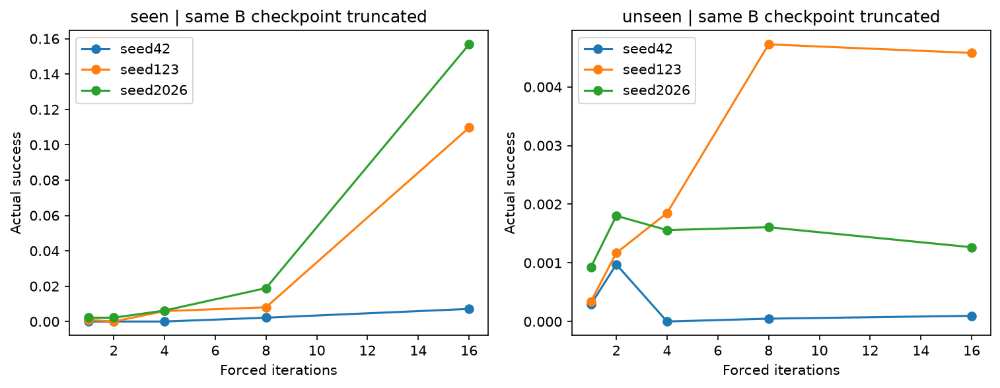

B의1/2/4/8회 절단, 기록 제거/0/역순/순환 재배치/다른 공식 문제 기록 결과는 SUMMARY.json의 diagnostics에 있습니다. 모두 사후 진단이며 중간 정답 손실을 훈련에 추가하지 않았습니다. 잠재 RMS 변화와2-step delta는 수렴/진동의 수치 진단이지 생각의 의미를 보여주는 증거가 아닙니다. Attention 비중도 사고내용 설명으로 해석하지 않습니다. 교란은 분포 밖 입력일 수 있으므로 정상 학습 B−C가 기록의 직접 비교입니다.

- seen/A: 벽 실패0.387047, 범위밖0.001446, 재방문0.544778, 감독셀의확신≥0.9오답0.003115. 성공조건부 비용비=1.0077954035487393, 성공중최적비율=0.9297419071389177.
- seen/B: 벽 실패0.626485, 범위밖0.000000, 재방문0.282306, 감독셀의확신≥0.9오답0.001663. 성공조건부 비용비=1.0044307304681068, 성공중최적비율=0.9609320917353341.
- seen/C: 벽 실패0.600145, 범위밖0.001963, 재방문0.322694, 감독셀의확신≥0.9오답0.001907. 성공조건부 비용비=1.0093200069229467, 성공중최적비율=0.9004296405654829.
- unseen/A: 벽 실패0.762610, 범위밖0.005536, 재방문0.231254, 감독셀의확신≥0.9오답0.131219. 성공조건부 비용비=1.065279165279165, 성공중최적비율=0.6125541125541125.
- unseen/B: 벽 실패0.842514, 범위밖0.000763, 재방문0.154743, 감독셀의확신≥0.9오답0.093283. 성공조건부 비용비=1.0195690508755169, 성공중최적비율=0.906164757228587.
- unseen/C: 벽 실패0.851377, 범위밖0.005065, 재방문0.142210, 감독셀의확신≥0.9오답0.104366. 성공조건부 비용비=1.0124402628434885, 성공중최적비율=0.9614695340501792.

## 데이터·무결성·한계·후속

[Moving AI 공식 출처](https://movingai.com/benchmarks/mapf/index.html)의 기존 원본 ZIP/member SHA-256과 실제 지도 벽·원본 시나리오 좌표를 대조했습니다. 데이터셋 `3e4d5629b9fe7e71`의 문제 ID·분할은 EXP004와 동일합니다. 거리장3,879개를 독립 BFS/Dijkstra로 검증하고, 적격52,516문제 전체에서 Oracle 최적 완주100%를 확인했습니다. 지도·시나리오 출처는 Moving AI이고, 복수 최적 방향 라벨은 이번에 계산한 파생 감독입니다. Open Data Commons Attribution License와 Stern et al., “Multi-Agent Pathfinding: Definitions, Variants, and Benchmarks”, SoCS2019를 인용합니다.

기존 H001/SH001 전체와 공식 자료를 포함한 data 전체3,799파일의 실행 전후 해시가 일치했습니다. 모든 solver와 종료 정책은 checkpoint 복원 후 로짓 해시·경로·지표가 재현됐고, 종료 학습에서 solver 가중치가 불변임을 검사했습니다. 원본 X 불변, 공유 코어16회, 모든 Attention의 gradient, 독립적인 history gradient, 최종 헤드1회, 행동 로그확률, 첫 종료·강제16회, 종료 후 추가 코어 호출 없음의 구조 검사를 통과했습니다.

Seed 표본 SD는 신뢰구간이나 유의성 검정이 아닙니다. 같은 지도·G를 공유하는 여러 S가 있어 문제들이 독립이 아니고, 미관찰 지도는2개뿐입니다. 관측 무저하 선택도 모집단에서 동등성을 증명하지는 못합니다. 완주하지 못한 모델의 계산 횟수 감소만으로 자율 사고 성공을 판정하지 않습니다. EXP004는 감독 목표·정책 디코더가 달라 성공률 차이를 잠재 상태만의 효과로 해석할 수 없습니다.

기본 v0.1은 동결 solver의 종료 학습까지 분리 검증했습니다. 공동 미세조정은 다른 학습 조건이고, 비공유 깊은 모델은 추가 학습 예산이 필요해 수행하지 않았습니다. 다음 연구에서는 먼저 epoch 상한만 늘려 최적화 부족의 영향을 분리하는 것을 권합니다. 고정16회 풀이 능력과 중간 readout의 유효성을 확인한 뒤 공동 종료 미세조정을 별도 run에서 검토할 수 있습니다.

## 원본 seed 결과

| 모델 | seed | 선택epoch | seen 성공률% | unseen 성공률% |
|---|---:|---:|---:|---:|
| A | 42 | 80 | 5.2371 | 0.0682 |
| B | 42 | 65 | 0.7127 | 0.0097 |
| C | 42 | 80 | 0.5268 | 0.1364 |
| A | 123 | 80 | 13.0772 | 0.1071 |
| B | 123 | 75 | 10.9699 | 0.4578 |
| C | 123 | 80 | 12.8912 | 0.1169 |
| A | 2026 | 65 | 1.7044 | 0.0049 |
| B | 2026 | 75 | 15.6802 | 0.1266 |
| C | 2026 | 80 | 9.1416 | 0.1510 |

## 실행과변경

실행 명령은 [README](README.md)에 있습니다. 구현은 공식 데이터 읽기·복수 정답 라벨·잠재 Attention·solver 학습/재개·종료 REINFORCE·공통 디코더/평가·기록 진단·시각화·검증·자동 실행/보고서로 분리했습니다. 지시문 원문은 프롬프트에 보존했고 상위 README에 SH002 링크를 추가했습니다. 대용량 원본·체크포인트·문제별 로짓·경로는 기존 ignore 정책으로 로컬에 보존하며, 요약 JSON·이 보고서·대표 그림은 Git 관리 대상입니다.

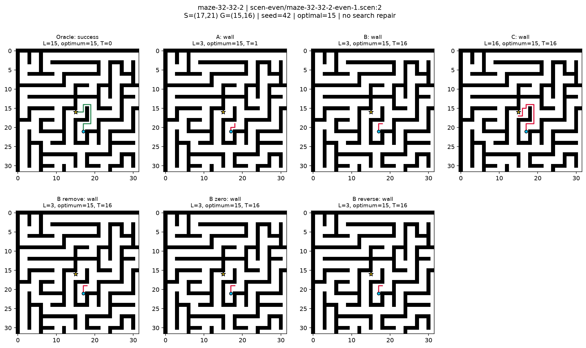

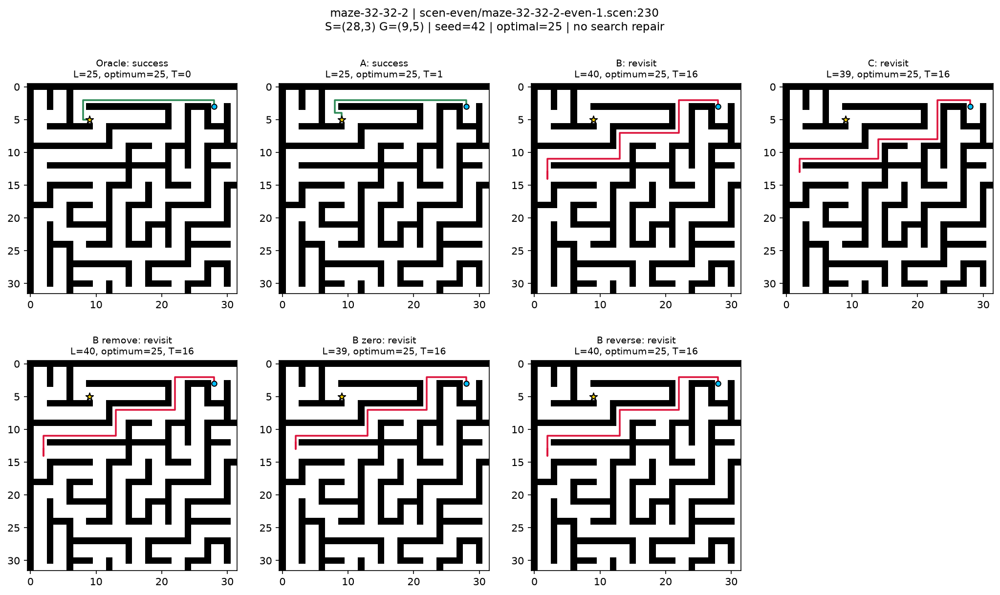

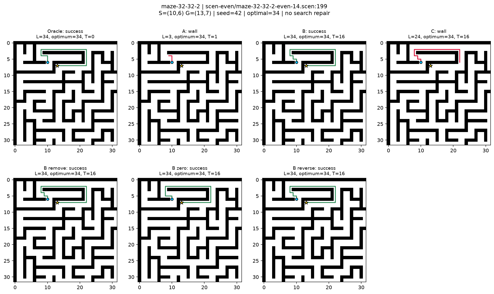

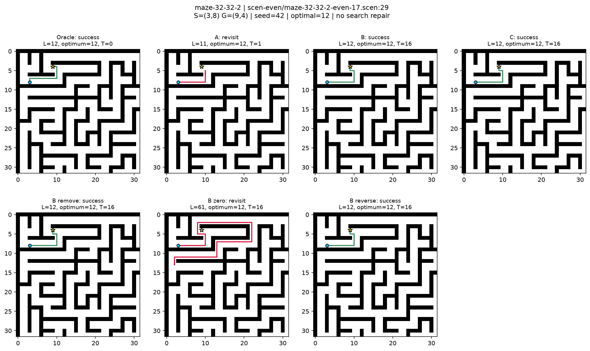

## 최종 추론 구현·지연 재검토

종료 학습 run은 `20261024_181350_halt_57bd85b2`이며 최종 추론 감사 run은 `20261024_185845_runtime_review_33602d1b`입니다. 종료 헤드 로짓을 한 반복에서 중복 계산하던 부분을 한 번 계산해 재사용하도록 정리했습니다. 어떤 가중치도 재학습하지 않았으며, 모든9개 종료 후보의 전체 테스트 로짓 SHA-256·경로·지표와 검증 결과가 원래 구현과 정확히 같았습니다. 원래 측정과 보고서도 감사 run의 initial_* 및 원래 학습 run에 보존했습니다.
초기 지연 측정은 첫 문제/배치 반복이었습니다. 최종 측정은 훈련 기준Q1~Q4로 층화한 공식 검증 문제를 섞어 batch1/16/64를 짝지어 측정하고 순서를 번갈았습니다. 모델만의GPU-resident지연이며 디코더·입출력전송은 제외합니다. 최대값은 측정 표본에서 관측된 값이며 모든 문제의 최악 지연 보장은 아닙니다. 테스트 성능으로 정책을 선택하지 않았습니다.

| seed | lambda | 검증 평균T | batch1 고정16 ms | 종료정책 ms | 종료정책 관측max ms | 채택 |
|---|---:|---:|---:|---:|---:|---|
| 42 | 0.0 | 16.00 | 13.564 ± 2.123 | 66.769 ± 14.367 | 96.387 | False |
| 42 | 0.001 | 16.00 | 13.323 ± 2.026 | 61.733 ± 10.785 | 96.464 | False |
| 42 | 0.01 | 16.00 | 13.952 ± 4.641 | 59.693 ± 4.379 | 78.260 | False |
| 123 | 0.0 | 16.00 | 13.835 ± 3.740 | 64.428 ± 15.792 | 125.406 | False |
| 123 | 0.001 | 16.00 | 13.906 ± 3.418 | 61.262 ± 7.922 | 95.626 | False |
| 123 | 0.01 | 16.00 | 13.233 ± 1.817 | 61.600 ± 9.855 | 97.534 | False |
| 2026 | 0.0 | 16.00 | 13.475 ± 1.874 | 68.011 ± 15.059 | 106.373 | False |
| 2026 | 0.001 | 16.00 | 14.885 ± 2.740 | 76.524 ± 17.656 | 101.685 | False |
| 2026 | 0.01 | 16.00 | 13.405 ± 1.962 | 63.208 ± 10.089 | 96.769 | False |

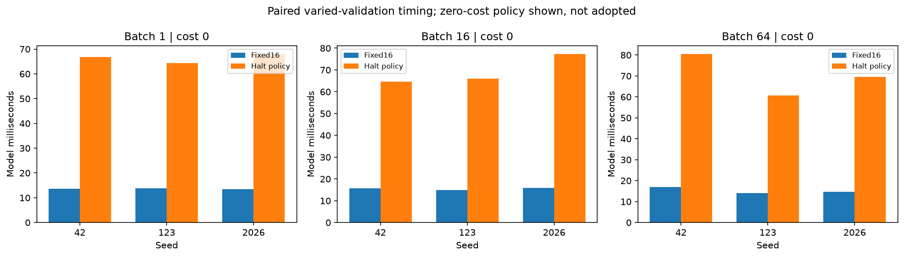

이 표의 ±는 측정 시행 간 표준편차입니다. 전체batch크기별 평균·표준편차·관측최대·대상문제ID는 SUMMARY.json에 있습니다. 평균 FLOPs는 각 실제 종료 분포의 F(T)를 평균하며, 고정 인코더·최종 출력 비용과 종료 헤드까지 포함합니다. 단순히 평균T/16을 전체 연산 비율로 사용하지 않습니다.

자율 종료 경로의 지연에는 활성 배치 압축·index 연산·종료 확인과 동기화 등 현재 구현의 비용이 포함됩니다. 종료 헤드의 Linear FLOPs만으로 이 지연을 설명할 수는 없습니다. 이 수치는 최적화된 모든 자율 종료 구현의 성능 한계를 뜻하지 않습니다. 다만 이번 정책은 실제 코어 반복 수도16회로 같아, 런타임 최적화 여부와 별개로 반복 계산 절약은 달성하지 못했습니다.

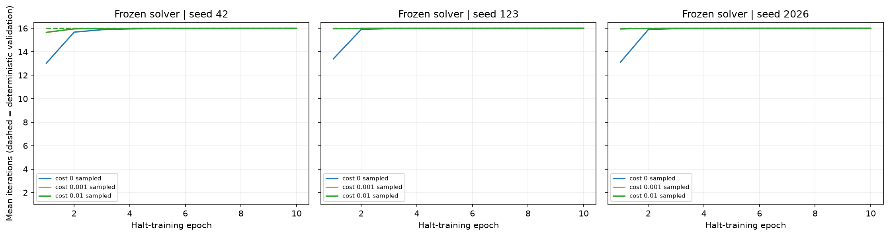

실선은 확률적으로 샘플링한 훈련 평균T, 점선은 결정적 검증 평균T입니다. REINFORCE surrogate 값은 최종 정책 NLL과 다른 값입니다. epoch별 평균 terminal NLL은 기록된 평균cost−2×실패율−lambda×평균T/16으로도 복원해 SUMMARY.json에 넣었습니다.

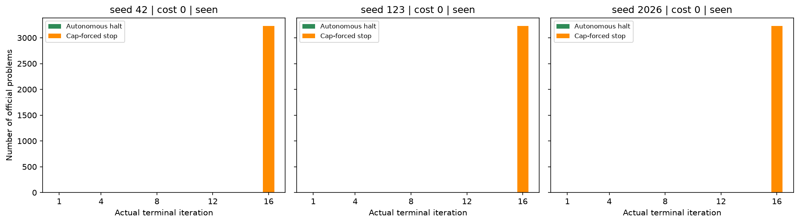

위 종료 분포 그림은 각seed의0비용 정책입니다. 다른 비용 후보도 검증·관찰 테스트에서는 모두16회 강제종료였습니다. 이 결과는 동결16회 solver와 시험한 비용0/0.001/0.01에서의 결과이며, 다른 비용·공동 학습·다른 구조에서도 종료가 불가능하다는 뜻은 아닙니다.

## 지도별 실제 경로 추가 사례

아래는seed42의 같은 공식 문제에 대한 Oracle/A/B/C입니다. 각 지도에서 B 완주가 있으면 첫 완주 사례, 없으면 첫 문제를 선택했습니다. 선택된 사례로 전체 성능을 추정하지 않습니다.

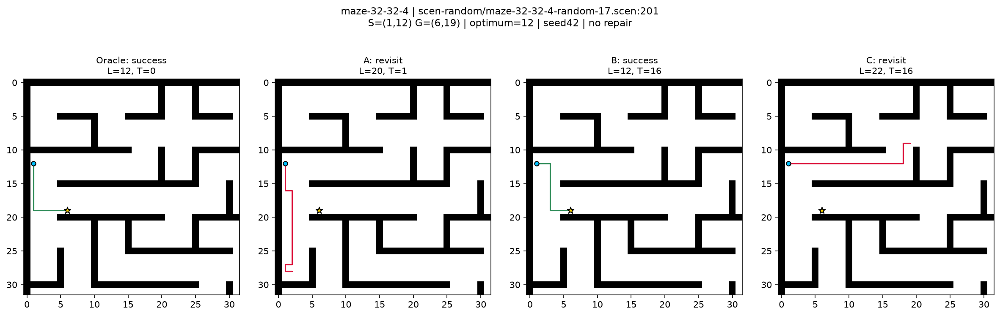

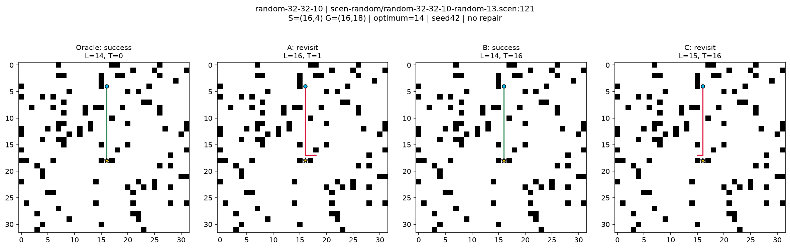

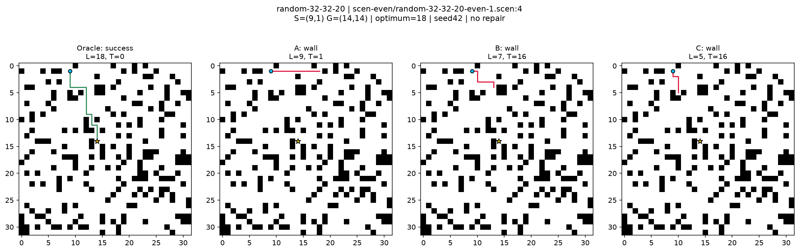

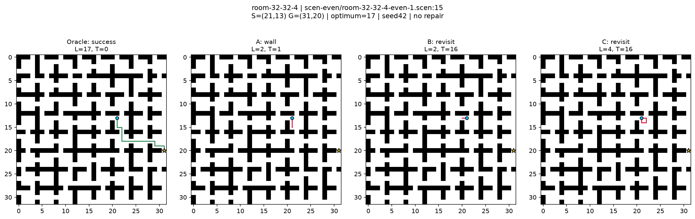

## 최종 감사 범위와 남은 한계

전체 방향 정책은 같은 지도·G에서는 S와 무관한 정답입니다. S는 실제 입력에 들어가지만 이 손실이 S 의존 처리를 강제하지는 않습니다. 같은 지도·G가 분할을 넘지 않도록 기존 정책을 유지했습니다. 원시 방향 argmax의 벽 충돌·재방문이 주요 실패였고, 정답 탐색이나 합법 방향 마스킹으로 복구하지 않았습니다.
기존 H001/SH001 및 공용data의3,799파일은 실행 전후 SHA-256이 같았습니다. 학습 run의 소스·설정·optimizer·RNG와 체크포인트는 보존했습니다. 데이터 전용 Phase0의 초기 소스 스냅샷 누락은 가장 이른 후속 불변 스냅샷의 동일 모듈 버전에서 복구해 recovered_source_provenance.json에 출처와 늦게 보관한 사실을 명시했습니다. 데이터 전용 단계에는 학습optimizer/RNG가 적용되지 않습니다.
통계는3seed의 표본SD이며 유의성이나 모집단 비열등성을 증명하지 않습니다. 문제가 같은 지도·목표를 공유해 독립이 아니고 지도 수가 작습니다. 가중치 공유·Attention 비중·잠재 변화량만으로 사고의 내용을 해석하지 않습니다. 종료 실패와 solver 학습 부족의 가능성도 구분해야 합니다.
실행 명령·재개 조건·run별 용도는 README.md와 RUNS.json에 있습니다. 원본/문제별 대용량 결과는 기존ignore정책으로 로컬에, 요약·보고서·대표그림은 Git 관리 대상으로 보존합니다.
